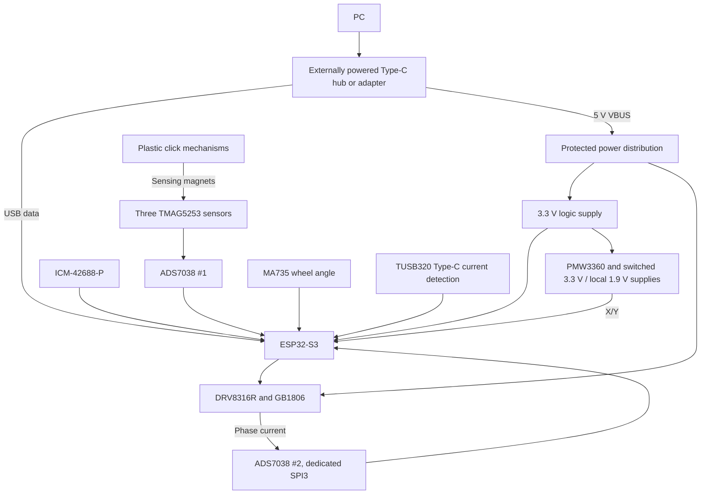

# V1 architecture

V1 is a wired USB mouse with three independently Hall-sensed, passive plastic buttons
and a motorized scroll wheel. Wireless operation and additional functional ICs
are outside the current feature scope; supporting power/protection circuitry
is drawn; remaining peripheral circuitry and physical validation are open.

| Requirement | Target / interpretation |
| --- | --- |
| Cursor | PMW3360DM-T2QU + LM19-LSI optical X/Y tracking |
| Supplementary motion | ICM-42688-P lift/orientation experiments; not the cursor source |
| Buttons | Left, middle, right; magnetic position sensing without switch contacts |
| Button return | Plastic mechanism supplies passive return |
| Button feedback | Mechanical plastic click; no button coils or powered force feedback |
| Scroll | MA735 absolute angle, programmable BLDC detents/torque |
| Host connection | USB 2.0 Full-Speed HID, target 1 ms report interval |
| Power | 5 V USB-C, source-aware limits; intended 3 A advertised source for full effects |
| Indicator | One RGB status/profile LED |
| Recovery | Reset, boot, programming/test access |

The button direction was revised on 2026-11-04: plastic mechanisms provide
the click and return force, and one sensing magnet per button moves relative
to its Hall sensor. Firmware applies calibrated thresholds and hysteresis;
the physical click feel is set by the mechanism. No button actuator coils,
actuator magnets or DRV8231A drivers remain in the active stacked variant.
The motorized wheel is unchanged. See the [button plan](../mechanical/button-mechanisms/README.md).

The mouse is a USB device. An external powered hub is a separate accessory, not
an assumption that every powered downstream port provides 3 A. A custom adapter
is optional future work; its controller, power switch, and Type-C source behavior
need their own design. USB2512B in the notes is only a candidate.

The [GPIO/resource allocation](interfaces.md) uses SPI2 for buttons/system ADC,
optical, IMU, angle and driver configuration; SPI3 is dedicated to the second
wheel ADC. Wheel control uses 3-PWM and RGB uses one RMT data pin. Validate
transaction latency, signal levels and sampling windows before routing. Loop
rates, current limits, USB identifiers, firmware framework and host protocol
still require implementation decisions and measurement.

Actuators must remain disabled until power capability, calibration, fault handling,
and limits are valid. Optical tracking and ordinary HID operation should remain
usable with haptics disabled.
