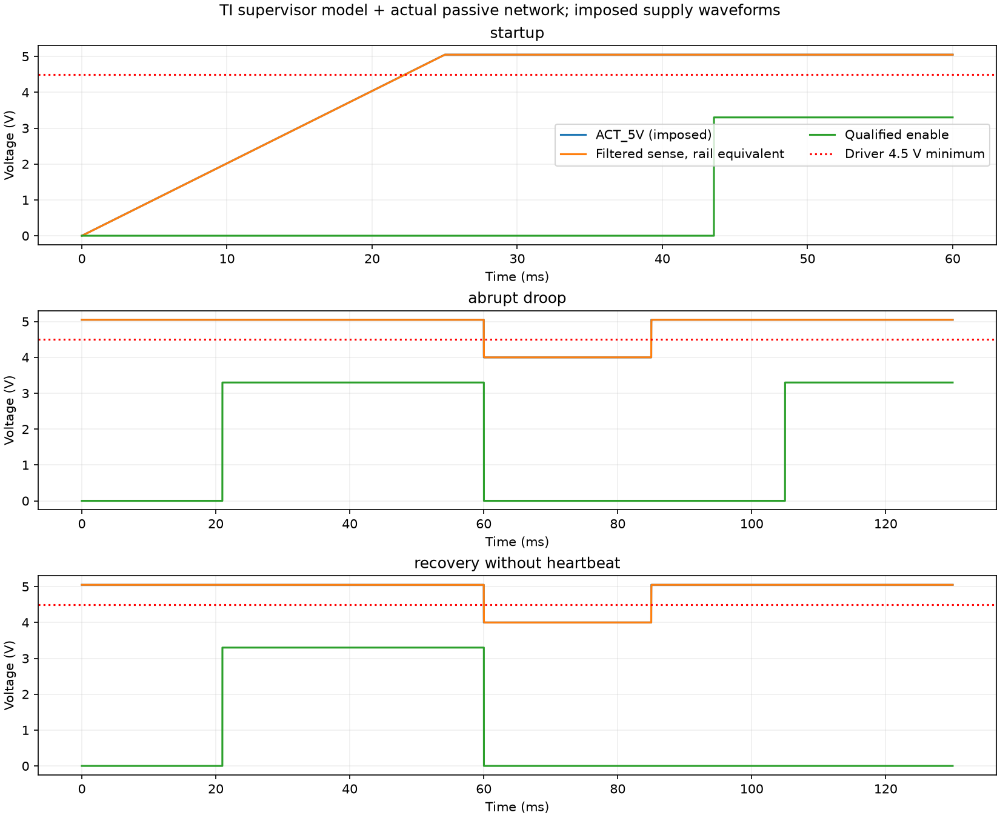
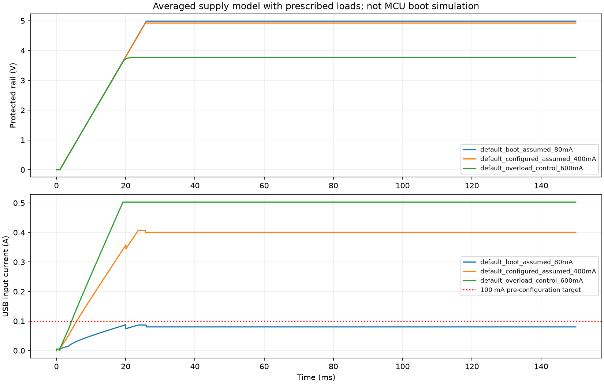
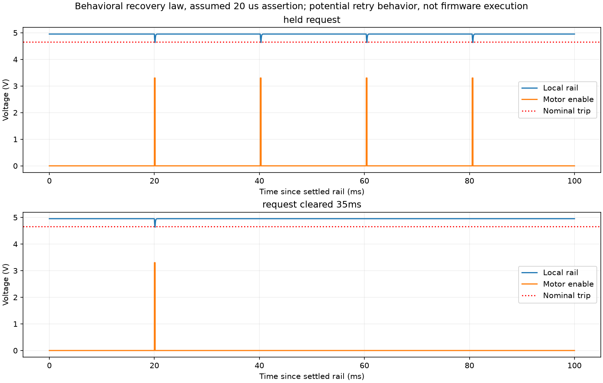

# Simulation review, 2026-11-06

The modeled interlocks work in the exercised cases. Supply headroom and rapid
droops remain material limits. **This is partial simulation validation, not
hardware acceptance or proof that the complete mouse will boot correctly.**

No schematic, PCB, BOM, firmware or manufacturing file was changed. Source hashes
were checked before and after the study. The full model definitions, assumptions,
manufacturer references and reproduction commands are in [README.md](README.md).

## Completed checks

- 256 steady gate combinations, evaluated using the native netlist's gate pins.
  Missing source permission, actuator request, sensor permission, reset permission,
  heartbeat permit, run request or local voltage-good blocks drive. Default USB
  does not enable the motor. Source-current decoding remains separate from USB
  configuration; the simulation does not implement a USB stack.
- 18 event-driven heartbeat cases: healthy, missing, stuck high, stuck low,
  asynchronous clear and rearm with heartbeat already high; each at selected
  7/10/15 ms timeout assumptions. Stuck high expires rather than holding drive on.
  Actual timeout corners and firmware scheduling remain unmeasured.
- Nine supervisor scenarios, each at 2 us and 1 us maximum timesteps: startup,
  slow/abrupt droop, repeated crossings, manual reset, absent permission,
  recovery without heartbeat, recovery without run request and a 5 us dip.
  Measured transition times agree within 20 us between timestep settings.
- Eight averaged supply scenarios, each at 4 us and 2 us maximum timesteps.
  Charge-balance, final-voltage and peak-current consistency checks pass.
  Both deliberate fault controls are detected: removing R35 blocks startup;
  a prescribed 600 mA default-source demand drives the supply into current limit.
- Two exploratory coupled supplier-model scenarios, each at 1 us and 0.5 us,
  plus eight independent behavioral recovery runs. The coupled supplier model
  has a recovery discrepancy described below; it is not counted as physical
  recovery validation.
- 128 static threshold corners and a selected droop-rate/filter/delay sensitivity
  sweep; two chip-select bias screens.

The independent [evidence review](results/review.json) recomputes measurements
from all 38 final SPICE waveform runs and verifies the source/artifact hashes.
Numerical checks and expected-fault detection must not be read as a claim that
every imposed operating condition meets the design's operating limits.

## Supervisor and interlock results

| Case | Simulation result |
| --- | --- |
| 0 to 5.05 V in 25 ms | Enable rises at 43.550 ms, after threshold crossing and recovery delay |
| 5.05 to 4.0 V in 1 us | Drive disabled 14.148 us after the drop begins |
| Rail recovers at 85 ms | Enable returns at 104.972 ms if permissions remain present |
| Same recovery, heartbeat permission absent | Drive stays off |
| Same recovery, run request removed | Drive stays off |
| Repeated 4.3/5.05 V excursions | One shutdown, then delayed recovery after the excursions finish |
| 5 us dip to 4.0 V | No enable interruption in this model; the filter suppresses the short event |

The abrupt-drop waveform spends approximately **13.590 us below 4.5 V while
enable is still high**. This is a nominal model result, not a guaranteed maximum
shutdown time. It directly shows why the circuit cannot promise instantaneous
inhibition before every voltage excursion below the driver's operating minimum.
The suppressed 5 us dip also remains below 4.5 V while enabled. The actual driver's
response during such events requires measurement.

The analytical minimum falling threshold is 4.532664 V before the reviewed
8.352 mV shared-feed allowance; approximately 4.524312 V after it. Maximum recovery
threshold is 4.927187 V in the selected full-temperature corners. Filter lag and
comparator delay consume this static margin during a falling rail. The selected
100 us delay stress is not a manufacturer-guaranteed limit.

## Supply headroom

Loads below are prescribed input-equivalent demands, not measured consumption
of the ESP32, sensor, radios or motor. The supply model uses the actual directly
connected capacitor inventory and screened copper resistance. It omits distributed
returns, switching ripple, thermal behavior and cable inductance.

| Imposed case | Peak USB current | Settled protected rail | Settled motor rail |
| --- | ---: | ---: | ---: |
| Default source; assumed 80 mA boot load | 87.66 mA | 4.985 V | Off |
| Default source; assumed 400 mA configured load | 406.53 mA | 4.923 V | Off |
| Default source; 600 mA overload control | 502.80 mA | 3.769 V | Off |
| 5 V / 0.15 ohm; 250 mA logic + 500 mA motor | 786.46 mA | 4.856 V | 4.768 V |
| 5 V / 0.15 ohm; 250 mA logic + 1 A motor | 1.286 A | 4.760 V | 4.583 V |
| 4.75 V / 0.50 ohm; 250 mA logic + 500 mA motor | 749.38 mA | 4.361 V | 4.277 V |

The last two supply-only cases deliberately keep their hypothetical load applied
after the voltage becomes insufficient. They demonstrate lack of headroom;
they do not predict that the real motor remains powered. A 3 A source advertisement
does not guarantee enough voltage at the driver. Motor demand must respect both
the source-current budget and local voltage.

The 80 mA load case fits the 100 mA startup target in this approximation. This
**does not validate ROM boot or enumeration current**. Their real waveforms are
unknown, and the model omits the eFuse FLT/reset interaction and thermal latch.

## Automatic-recovery discrepancy and retry risk

The coupled TI macro-model plus 1 A load initially enables at about 103.818 ms and
disables at 103.992 ms. It then keeps RESET asserted even after the rail returns
above the recovery threshold. Coarse 4/2 us simulations produced different retry
counts. Fine 1/0.5 us runs agree but still do not reproduce the documented recovery
contract for this short load-induced dip.

This is an **unresolved model/datasheet discrepancy**, not evidence that hardware
will latch off. The 2011 model's ngspice adaptation has not been cross-validated
against PSpice or silicon. Both coupled supplier-model runs are excluded from
hardware recovery qualification. Long imposed brownout/recovery tests do recover.

An independent model implementing the datasheet's recovery state law shows the
other relevant possibility: with the run request held high, a marginal supply
produces brief motor-enable pulses about every 20.17 ms. Clearing the request
prevents further pulses in the modeled cases. This is conditional evidence of
a retry risk, not executed firmware or a validated motor-current waveform.

Keep the existing firmware requirement to abort/reduce an effect on undervoltage
and require controlled rearming. Do not rely on either automatic recovery or an
assumed latch to produce acceptable haptic behavior under a persistent overload.

## Chip selects and remaining bench work

CS_DRV8316 and CS_ADC2 both screen at 2.533 V nominal. With 3V3 +/-5%, resistor
1% corners and a selected +/-10 uA aggregate leakage allowance, the minimum is
2.318 V: 0.318 V above the receiving buffer's 2.0 V threshold. This supports the
earlier assessment that the opposing pulls are an optional margin improvement,
not a demonstrated logic failure. Power sequencing and disconnected-harness
states are not qualified by this static calculation.

The following remain **UNVERIFIED**:

1. Actual ROM/application boot and USB enumeration current, including reset loops.
2. Real heartbeat timeout corners and scheduler jitter; SPI/back-power behavior.
3. DRV8316 nSLEEP leakage with VM off. No applicable leakage model was found.
   Absolute-maximum voltage ratings do not establish powered-off isolation.
4. Shutdown latency across temperature/overdrive, brief rail dips and driver
   behavior below 4.5 V; measure ACT_5V, SENSE, WHEEL_RUN_EN and phase outputs.
5. Recovery after short load-induced trips and persistent-request retry behavior.
6. Rail ripple, ground bounce, actual motor transients, regeneration, thermal
   limits, current limits and mechanical sensor/magnet behavior.

These results do not justify a new PCB change by themselves. They do justify
retaining the undervoltage abort/rearm firmware requirement and prioritizing
supply-headroom and short-dip recovery tests on the first prototype.
