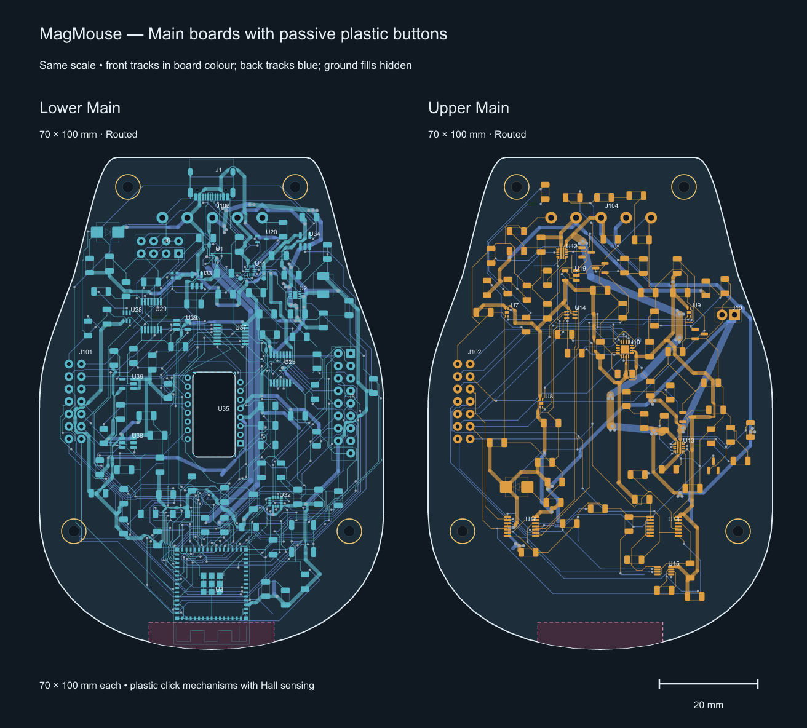

# MagMouse stacked two-layer boards

All four boards are routed and have independent schematics. Native KiCad 10.0.6
checks report zero ERC findings, DRC findings, unconnected items and schematic
parity findings under the saved rules. The [quote package](quote-package/README.md)
contains the files for supplier pricing; physical and supplier acceptance remain open.

The active boards use 1206 packages for all 193 resistors and ceramic capacitors
that previously used 0603 or 0805. Values and pin/net assignments are unchanged.
[1206-PARTS.md](1206-PARTS.md) lists the replacement manufacturer part numbers,
ratings and sourcing status. [1206-review.json](1206-review.json) records the
earlier package migration; [assembly-spacing-review.json](assembly-spacing-review.json)
records the subsequent 2 mm component spacing and outline changes.

The standard-via revision uses 0.30 mm via drills and at least 0.45 mm copper
lands. All four boards are checked for via-hole/SMD-land overlaps. The derived
[238 × 114 mm panel](panel/Panel.kicad_pcb) combines one of each board using
2 mm routed gaps and 5 mm mouse-bite tabs. Source copper is copied exactly,
with isolated net names for each board; individual outlines remain unchanged.

| Board/project | Dimensions | Copper layers | Original circuit footprints | Added interface/mount footprints |
| --- | --- | ---: | ---: | ---: |
| [Lower](lower/Lower.kicad_pro) | 70 × 100 mm, tapered | 2 | 122 | 6 |
| [Upper](upper/Upper.kicad_pro) | 70 × 100 mm, tapered | 2 | 86 | 6 |
| [Wheel](wheel/Wheel.kicad_pro) | 70 × 67 mm, clipped Main profile | 2 | 87 | 0 |
| [Encoder](../encoder/Encoder.kicad_pro) | 14 × 18 mm, two 4 mm upper chamfers | 2 | 3 | 0 |

[All-board overview](all-boards.png). Component footprints, pads and drills are
full size. Both Main outlines retain the approved taper and 38.5 mm front edge.
Wheel follows the Main sidewalls between y = 26 and 93 mm. Its 4,448 mm² outline adds 1,148 mm² to the previous rectangle. Wheel coordinates plus (7.5, 29) mm align it with Main in plan view. Stack height and Wheel mounting need mechanical fit confirmation.

[Wheel power and ground review](routing-review/POWER-GROUND.md) covers trace necks, via barrels, GND pours and the reordered brake feedback resistors.

[3D exports](3d/README.md) include STEP, GLB and angled previews for each board
and the panel, plus bare substrate STEP files. The populated exports include
available library models; the coverage report identifies 14 missing component
bodies. These are PCB models, not a mechanically positioned mouse assembly.

## Circuit and schematic split

Lower contains the ESP32, USB connector and data/CC circuitry, 3.3 V regulator,
optical sensor and local supplies, IMU, RGB, encoder interface and Wheel signal
connector J8. Upper contains the eFuses, power monitoring, three Hall sensors,
ADC1, hardware interlock and Wheel power connector J10.

The independent [Lower schematic](lower/Lower.kicad_sch) and
[Upper schematic](upper/Upper.kicad_sch) each include `20_Stack_Harness` with the
actual signal/power arrays and mounting holes. PCB symbol paths match these
projects. The combined [Main circuit](main-circuit/Main.kicad_sch) is retained as
the migration reference; edit the independent projects for subsequent work.
Every retained component value and pin/net connection was compared with that
reference. USB data/CC and analog Hall/current-sense/ADC connections stay local
to their respective boards.

Buttons use passive plastic click mechanisms and one sensing magnet per Hall
sensor. The active design removes 38 button-only parts, including U4/U5/U6,
J2/J3/J4 and U17. ADC1 channels 3–5 are grounded spares; GPIO4–9 are unused.
U18 retains the shared HALL_EN gate. Wheel drive, interlock, ACT_5V protection
and shared storage remain. [passive-buttons.json](passive-buttons.json) records
the exact removed parts and pin changes. The older routed checkpoints retain
the superseded button-coil circuitry.

## Wiring

The Main stack has **19 wires with three shared grounds**:

| Interface | Signals/supplies | Grounds | Total |
| --- | ---: | ---: | ---: |
| J101 ↔ J102 | 13 signals | 1 | 14 |
| J103 ↔ J104 | 3 supply rails | 2 | 5 |

Connect equal pad numbers using [WIRE_MAP.md](WIRE_MAP.md). Signal arrays are
2 × 7 at 2.54 mm pitch: x = 6/8.54 mm, y = 42–57.24 mm, 1.8 mm lands and
0.8 mm drills. Five power pads use 5.08 mm pitch at x = 25–45.32 mm,
2.4 mm lands and 1.2 mm drills. Both power arrays moved together to y = 12.25 mm
to provide assembly space below USB. Raw VBUS goes up, PWR_5V returns to Lower and
+3V3 goes back up. ACT_5V stays on Upper and feeds Wheel.

The Wheel harness also has **19 wires with three shared grounds**. Lower J8
and Wheel J9 each use 17 pads in a 2 × 9 grid with one hole omitted; their copper
envelope is 22.12 × 4.34 mm. Upper J10 and Wheel J11 carry ACT_5V and the third
ground. See [WHEEL_WIRE_MAP.md](WHEEL_WIRE_MAP.md). Wire gauges, cut lengths and
stack height still depend on the mechanical assembly.

## Placement and routing

Separate front components have at least 2 mm between their body-and-solder-land
envelopes. This does not change the pitch of pins within an IC or wire array;
copper-only test access is excluded from the component spacing measurement.
The circled Upper passive group has at least 3 mm clearance to the board edge.
The layouts retain the USB, optical, Hall, antenna and mounting datums. The two
stack power arrays move together by 1.25 mm; their pitch and pin map are unchanged.
Other parts and colliding front test pads move as recorded in the spacing review.
Fitted electronic parts remain on the front; several diagnostic test pads are
on the back. Encoder retains its sensor and wire-array positions; its two
4 × 4 mm chamfers remove 16 mm², reducing outline area from 252 to 236 mm².

The long USB pair was placed before routing, around the right side of the
optical reserve, using the inherited 1.10 mm trunk width and 0.15 mm nominal
gap with narrow land escapes. The 1206 revision retains that corridor and adapts
the resistor-end escape. Freerouting 2.5.0 and local geometric routing helpers
rebuilt connections affected by the larger packages. KiCad then checked minimum
track/via sizes, filled and stitched ground copper,
removed unused fanout vias, and checked actual connectivity and clearances.
Power escapes were widened where geometry permits. The fabricator's stack and
physical USB, power, thermal and analog performance still need verification.

Aligned M2 mounting candidates remain at (18,6), (52,6), (7,76), (63,76) mm:
2.2 mm holes and 5 mm support envelopes. Lower now has a real 17.26 × 8.60 mm
optical opening on Edge.Cuts, following PixArt PMW3360 datasheet R1.50 Figure 3.
In board coordinates it spans x = 31.20–39.80 and y = 43.68–60.94 mm; U35's
optical center remains (35.5,52.5) mm. Internal corners use R1 mm for the panel's
nominal 2 mm router; this corner geometry requires lens-fit confirmation.
The lens faces downward through Lower,
so this does not add a duplicate opening to Upper. Lens retention and stack
height still need mechanical fit confirmation. U3 stays at (35,89.25) mm,
with its antenna approximately 0.43 mm from
the curved board edge at the corners. The requested 5 mm reserve is
x = 22.3–47.7, y = 94.5–104 mm on both boards, extending beyond the rear edge.
Upper retains substrate over that region; assembled radio performance is untested.

## Validation and quote files

[routing-review/summary.json](routing-review/summary.json) records current board
hashes, sizes, layer counts, ERC/DRC/parity results and fabrication dimensions.
The native reports, exported netlists, front/back copper SVGs and track-width
measurements are alongside it. Inherited ignored categories remain explicit in
the reports; no new DRC or ERC exclusions were added for routing.

[MagMouse-quote-package.zip](MagMouse-quote-package.zip) includes four separate
Gerber/drill ZIPs, per-board BOM/CPL CSVs, combined purchasing inventory, manual
items and via-in-pad intersection lists. Read its [quotation notes](quote-package/README.md)
for stack, assembly, stock, shipping/tax and mechanical assumptions. This is a
pricing package. The [first live quote](quotes/2026-11-04-jlcpcb/QUOTE.md) records
the superseded 0.20 mm, separate-board version. The [standard-via panel quote](quotes/2026-11-04-panel-standard-vias/QUOTE.md)
was EUR 42.83 for five complete sets, or USD 99.25 delivered by EuroPacket DDP
to Croatia (4 November 2026). That quote predates the 1206 migration and has not
been refreshed for these files. No fabrication order is placed.

`partition.json` preserves ownership and the checked 19-wire contract.
`placement-positions.json`, `spacing-review.json`, `spacing-baseline.json`,
`placement.svg/png` and `passive-validation.json` are historical pre-routing
evidence; their old board hashes and airwire counts are not current route results.

## Reproduction

Use KiCad 10 Python. Edit the independent KiCad projects for future circuit or
layout changes. The one-time split and obsolete placement generators are now
in [Git history](../../../docs/history/README.md). Shared libraries and helper
functions live in [hardware/common](../../common/README.md).

`route_main.py` exports/imports Specctra sessions, `route_usb.py` defines the
initial USB corridor, `finish_main.py` fills and stitches ground, and
`widen_power.py` widens power where clearance and keepouts allow. Freerouting
2.5.0 used neck retry at 150 µm with the optimizer disabled for Lower. Lower's
DSN clearance was increased to 165 µm to leave margin for native minimum-width
restoration; saved KiCad clearances remain unchanged. Temporary sessions, router
binaries and logs stay in ignored `build/sandwich/main-routing`.

`export_quote.py` rechecks all four boards before exporting the package and
compares Main pins against the retained migration reference. `overview.py`
renders placement views; add `--main-only --copper` for the routed Main image.
The netlist and schematic-parity checks cover the current Wheel harness.
The obsolete harness conversion script is retained in Git history.

`standard_vias.py` records the one-time drill migration and assists local via
relocation; `repair_wheel.py` and `continuous_routes.py` provide local path repairs.
`standard-via-review.json` is historical evidence for the pre-1206 revision. It records unchanged component placement and pad/net identity,
unchanged motor-phase/brake copper, and the final drill and via-in-pad counts. The finished
KiCad boards are the editable source. `panelize.py` derives and verifies the
combined manufacturing panel and exports its Gerbers/drills. Its verification
compares every source pad, track, via drill and filled-zone vertex after translation,
checks connected substrate and router access, and runs native panel DRC.

`large_passives.py` performs the guarded one-time 1206 migration and verifies it
against the saved pre-migration snapshots in ignored `build/sandwich/1206`.
`1206-migration.json` records the per-reference purchasing substitutions;
`1206-review.json` records the final checks and source hashes. Do not rerun
the migration on an already converted project. `region_routes.py` supports
local two-layer repairs; every saved result still requires native KiCad DRC.

The fabrication rules explicitly use JLCPCB's 0.075 mm via annular ring and
0.20 mm via-hole-to-copper clearance, replacing 0.125/0.25 mm in the earlier
revision. Via hole-to-hole clearance stays 0.25 mm, copper clearance stays
0.15 mm by net class (0.127 mm board minimum), and minimum track width stays
0.127 mm. No additional DRC categories are ignored. These limits are based on
[JLCPCB's published capabilities](https://jlcpcb.com/capabilities/pcb-capabilities/).

Hardware: CERN-OHL-S-2.0. Scripts: GPL-3.0-or-later. Documentation: CC-BY-SA-4.0.
