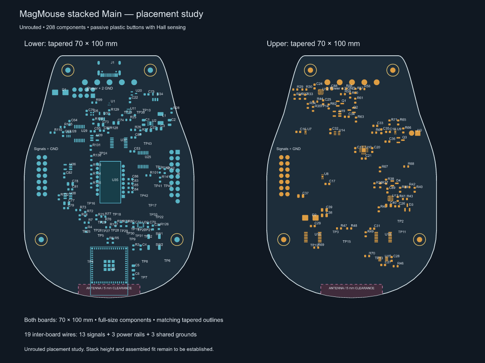

# Stacked two-layer Main — 70 × 100 mm

Both boards use the same **70 mm wide × 100 mm long tapered outline**. The
inter-board harness is **19 wires with three shared grounds**. Plastic mechanisms now produce the
button clicks; Hall sensors read the sensing magnets. The 208 retained original
footprints remain at full size. The earlier coil design had 25 wires.



| Board | Dimensions | Original footprints | Added interface/mount footprints |
| --- | --- | ---: | ---: |
| [Lower](lower/Lower.kicad_pro) | 70 × 100 mm | 122 | 6 |
| [Upper](upper/Upper.kicad_pro) | 70 × 100 mm | 86 | 6 |

The outline retains the earlier taper, scaled from 80 × 125 mm to 70 × 100 mm.
The front edge is now 38.5 mm wide. Board area is 30% smaller than the previous
sandwich. Components, pads and drills are **not scaled**: the placement has been
reworked using full-size footprints and clearance checks.

These remain **unrouted placement studies**, with no independent split schematics.

## Circuit split

Lower contains the ESP32, USB connector and data/CC circuitry, 3.3 V regulator,
optical sensor and local supplies, IMU, RGB, encoder interface and Wheel signal
interface. Upper contains the eFuses, power monitoring, three
Hall sensors, ADC1 and hardware interlock. Wheel power J10 stays on Upper;
Wheel signals J8 stay on Lower.

USB data/CC and the analog Hall/current-sense/ADC connections remain local to
their respective boards. A matching [Wheel variant](wheel/Wheel.kicad_pro) uses
the smaller wheel harness below. The earlier routed checkpoints and Encoder
board are unchanged.

## Passive buttons — 2026-11-04

Removed 38 button-only parts: U4/U5/U6, coil connectors J2/J3/J4, their
support components, U17 and its command bias parts. U7/U8/U9 Hall sensors
and U10 ADC remain. ADC1 channels 3–5 are grounded spares. U18 stays because
one gate supplies the shared HALL_EN signal; its unused inputs are grounded.
The wheel motor, wheel interlock and shared ACT_5V protection/storage remain.
[passive-buttons.json](passive-buttons.json) records the exact inventory and pin
changes. The original routed checkpoints retain the historical coil circuitry.

## Wheel harness

The wheel connection is **19 wires with three shared grounds**, reduced from
32 wires with 16 grounds. [WHEEL_WIRE_MAP.md](WHEEL_WIRE_MAP.md) lists every
connection. J8 on Lower and J9 on Wheel now have **17 pads**: 14 signals, +3V3,
and two grounds. The existing J10/J11 pair carries ACT_5V and the third ground.

Both signal arrays use a 2 × 9 grid with one hole omitted. Their copper envelope
is **22.12 × 4.34 mm**, down from 37.36 × 4.34 mm (41% shorter). Pads retain
1.8 mm copper and 0.8 mm drills. Connect J8.N to J9.N; this replaces the old
reversed 30-pin numbering. All signal and supply functions are retained.

[main-circuit/Main.kicad_sch](main-circuit/Main.kicad_sch) is the complete Main
circuit reference with the new J8 interface and passive-button revision. It is not yet split into independent
Lower/Upper schematics. The matching Wheel project has its own updated schematic.
Wheel routing is complete with **zero native DRC findings, zero unconnected items,
and zero schematic-parity findings** under the inherited rules. The stacked Main
boards remain unrouted placement studies.

The Wheel PCB is now **55 × 60 mm**, reduced from 80 × 75 mm: **45% less area**.
All components and signal/power tracks retain their placement and geometry. Two
ground stitching vias in the removed outer margin were removed, and both ground
pours were resized and refilled. Wheel and Encoder both have **two copper layers**;
Encoder remains 14 × 18 mm. [wheel-size.json](wheel-size.json) records the change.

## Reduced wiring

[WIRE_MAP.md](WIRE_MAP.md) gives the new pin numbering. This supersedes the
previous 25-wire map; the pin numbers have changed.

| Interface | Signals or supplies | Shared grounds | Total wires |
| --- | ---: | ---: | ---: |
| J101 to J102 | 13 signals | 1 | 14 |
| J103 to J104 | 3 power rails | 2 | 5 |
| **Total** | **16** | **3** | **19** |

The three ground wires connect the same common GND net. There is no longer a
separate ground wire for every control signal. The signal ground is beside the
SPI pins. The two power grounds share the supply return; final wire gauge and
cut lengths will be chosen with the stack height.

Raw VBUS goes up to the protection circuitry, protected PWR_5V returns to the
lower regulator, and +3V3 goes back up. ACT_5V stays on Upper and feeds Wheel
through J10. GPIO4–9 are now unused; six button-command wires have been removed.

The signal array is now 2 × 7 pads instead of 2 × 10. Odd pins are at x = 6 mm,
even pins at x = 8.54 mm, with rows from y = 42 to 57.24 mm. Only pin 1 is GND.
The five power pads are at y = 11 mm, starting at x = 25 mm with 5.08 mm pitch;
pins 1 and 5 are GND. Pad numbers match directly between the two boards.

## Placement and mounting

The crowded groups have been spread across more of each board. Lower's power,
optical support and IMU groups are farther apart; Upper's
protection, sensing and interlock groups use more of the middle and rear area.
USB, the optical sensor, ESP32 antenna, Hall sensors, connectors and mounting
positions remain fixed. Supporting parts follow their ICs; capacitor/inductor
centre distances to their assigned IC or LED increase by no more than 0.75 mm.

The spacing solver targets a 0.6 mm courtyard gap for movable general parts and
0.3 mm for capacitors/inductors. Fixed interfaces retain their approved spacing.
Across the affected groups, the median nearest courtyard gap increased from
0.25 to 0.53 mm on Lower and from 0.30 to 0.65 mm on Upper. These are placement
clearances, not copper design-rule values. [spacing-review.json](spacing-review.json)
records the measurements and anchor checks; [main-boards.png](main-boards.png)
shows the revised placement. [placement-positions.json](placement-positions.json)
records every original and new position. Routing and electrical layout review
remain to be completed.

Four aligned M2 mounting candidates are at (18,6), (52,6), (7,76) and (63,76) mm,
with 2.2 mm holes and 5 mm support envelopes. The lower optical aperture reserve
moves with the PMW3360. The antenna uses the requested **5 mm clearance** on
its three free sides, reduced from 15 mm for the intended few-metre radio range.
U3 is now at **(35, 89.25) mm**, moved 15.25 mm towards the rear edge. Its
antenna end reaches y = 99 mm, approximately 0.43 mm from the curved edge at
the outer corners (1 mm at the centre). The surrounding MCU circuitry follows
the new placement. The reserve is **25.4 × 9.5 mm**, at x = 22.3 to 47.7 mm and
y = 94.5 to 104 mm on both boards; the outward clearance now extends beyond
the PCB edge. This includes the antenna area itself; the feed side meets the
module body. Upper still has substrate above the antenna area.
The lower module's adjusted keepout and courtyard are stored in the local
`MagMouseSandwich.pretty` footprint library; the stock library is unchanged.

Stack height, USB access, button magnet alignment and lens fit remain to be
established. Radio performance has not been tested in the assembled stack.

## Validation

KiCad 10.0.6 reports **zero non-connectivity DRC findings** on both boards under
the inherited rules. There are **343 unconnected items on Lower and 204 on Upper**,
as expected for these unrouted studies. The reported pass is a placement check,
not a routed-board or schematic-parity pass.

The generator verifies:

- Both boards have the same requested 70 × 100 mm outline and two copper layers.
- All 208 retained original component references occur once. J8 has the revised
  17-pad interface. Only the documented passive-button pin changes are allowed;
  unrelated values, packages and pin connections are preserved.
- All 17 boundary nets are represented by the 19-wire harness.
- All corresponding saved wire pads have matching net names and XY positions.
- New wire pads and mounting support envelopes fit inside the tapered outline.

[partition.json](partition.json) records component ownership, original boundary
endpoints, wiring, board hashes and validation results. Native DRC reports are
saved beside each PCB. Inherited ignored checks remain listed in those reports.
The separate [wheel-interface.json](wheel-interface.json) verifies all 19 saved
wheel wire assignments, three grounds, and the Wheel variant's routing/parity.

## Rebuild

```powershell
& '<KiCad>/bin/python.exe' hardware/two-layer/sandwich/build_study.py
```

The generator and [compact_placement.py](compact_placement.py) overwrite the
study boards, projects, reports, wire table and SVG/PNG previews. They read the
original compact PCB and revised Main circuit reference netlist. Original boards are
never written. The scripts use Shapely and resvg-py from `build/two-layer/python`.

`wheel_interface.py prepare` regenerates the Main circuit reference and Wheel
schematics, then resets only the Wheel interface routing for a fresh routing run.
It overwrites the Wheel variant: do not use it as a routine validation command.
Route its `build/sandwich/Wheel-19wire.dsn` output, then use
`wheel_interface.py import` to load `Wheel-19wire.ses`, restore the project's
minimum track/via dimensions, refill copper, and save. `wheel_interface.py verify`
runs native Wheel DRC/parity and checks the actual saved harness pads.
This revision used Freerouting 2.5.0 with ground pours refilled in KiCad after
import. The native KiCad results are the final connectivity and DRC evidence.
`compact_wheel.py` applies the 55 × 60 mm outline to the routed Wheel variant,
preserving all retained copper. Run it after a fresh interface routing rebuild,
then run `wheel_interface.py verify` and `overview.py` to refresh the evidence
and the [all-board overview](all-boards.png).
`spaced_groups.py` defines the spacing targets relative to `spacing-baseline.json`.
After regenerating Main, `review_spacing.py` checks the fixed anchors and support
part distances. `overview.py --main-only` renders the two Main boards together.

Next implement the split Main schematics and route the stacked boards.

Hardware: CERN-OHL-S-2.0, as in [../../LICENSE](../../LICENSE).
Scripts: GPL-3.0-or-later. Documentation: CC-BY-SA-4.0.
