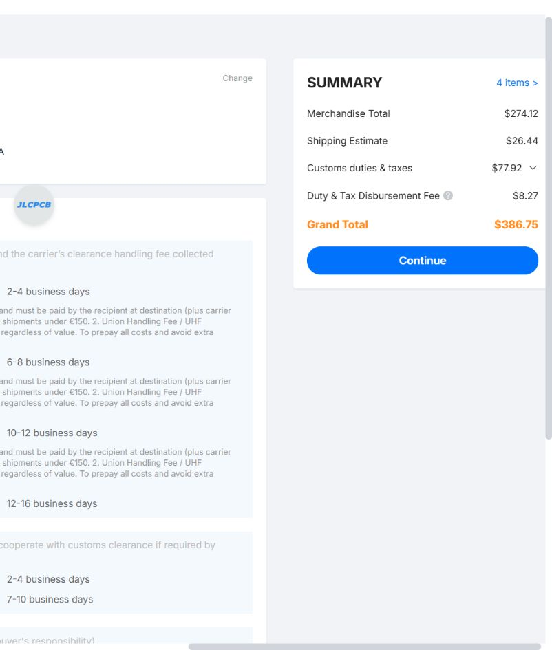

# JLCPCB live quotation — 4 November 2026

Quote only. No order submitted and no payment made.

The current four Gerber ZIPs were uploaded to JLCPCB and saved as four separate
designs. This quote covers **five of each board (20 PCBs, five complete sets)**,
with delivery to Croatia 43000. It excludes components, assembly, stencils,
mechanical parts and inter-board wiring.

| Board | Dimensions | Quantity | Cart job | Batch price, EUR |
| --- | --- | ---: | --- | ---: |
| Lower | 70 × 100 mm | 5 | Lower-gerbers_Y14 | 64.63 |
| Upper | 70 × 100 mm | 5 | Upper-gerbers_Y15 | 64.63 |
| Wheel | 55 × 60 mm | 5 | Wheel-gerbers_Y16 | 96.85 |
| Encoder | 14 × 18 mm | 5 | Encoder-gerbers_Y17 | 18.57 |
| **Total** | | **20** | | **244.68** |

All are two-layer FR4, nominal 1.6 mm, 1 oz outer copper, green solder mask,
white silkscreen and ENIG with 1 microinch gold. Regular outline tolerance and
standard production time were selected. There is no paid impedance service.

Lower, Upper and Wheel use the calculator's 0.20 mm minimum-via option, matching
the source drill minimum. JLCPCB automatically adds small-via processing and
4-wire Kelvin testing. Lower and Upper use plugged vias, which the calculator
requires for that option. Wheel uses epoxy-filled and copper-capped vias plus
the required horizontal electroless copper plating. Encoder uses standard
0.30 mm minimum vias with tenting; JLCPCB adds small-board deburring.

The calculator's via help distinguishes its multilayer exemption for 0.20 mm
holes with 0.45 mm lands. That exemption was not assumed for these two-layer
boards. The selected quote tier remains subject to the supplier's actual CAM
review; the source vias have 0.45 mm lands rather than the smaller lands named
on the calculator button.

## Delivered checkout totals

**The cart displays EUR, but checkout displays USD.** These are the actual
checkout values, not currency conversions.

| Charge, USD | DHL Express DDP | EuroPacket DDP |
| --- | ---: | ---: |
| Merchandise | 274.12 | 274.12 |
| Shipping | 26.44 | 32.26 |
| Customs duties and taxes | 77.92 | 76.60 |
| Duty and tax disbursement fee | 8.27 | 0.00 |
| **Delivered total** | **386.75** | **382.98** |
| Quoted transit, business days | 2–4 | 7–10 |

Each board was quoted at three days production. Transit is additional.
The checkout was left with DHL DDP selected, before final submission.
No coupons or desktop-app discounts were applied.

## Main price drivers

For each main-board batch, the displayed breakdown was EUR 3.57 base,
14.82 via plugging, 15.53 ENIG, 15.54 small-via processing, and 15.17 Kelvin
testing. For Wheel it was EUR 3.57 base, 45.02 filled/capped vias, 15.17 ENIG,
15.13 small-via processing, 14.96 Kelvin testing, and 2.99 via plating.

Board area is therefore not the dominant cost at this quantity. A future
cost-reduction revision could investigate larger via drills and removing
Wheel via-in-pad placements. That would require layout changes and renewed
DRC/quotation; no fabrication geometry was changed for this quote.

The earlier September panel quote included a shared stencil and three designs.
This four-design separate-board quote is a different scope and should not be
presented as a direct like-for-like comparison. The final optical lens aperture
and mechanical fit remain unresolved as documented in the quotation package.
Additional milling or supplier review can change the final price.

Source: live JLCPCB [cart](https://cart.jlcpcb.com/shopcart/cart/) and its
pre-calculation checkout, observed 4 November 2026. Saved job IDs and exact
uploaded file hashes are recorded in `quote-observations.json`.
