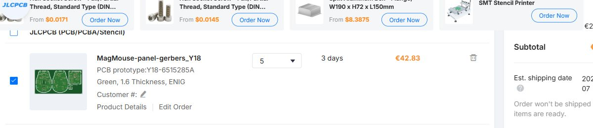
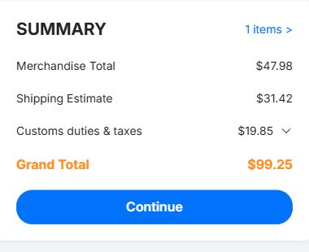

# JLCPCB panel quote — 4 November 2026

**Five panels cost EUR 42.83; delivery to Croatia 43000 totals USD 99.25
with EuroPacket DDP or USD 109.97 with DHL Express DDP.** No order was submitted
and no payment was made.

Each 223 × 114 mm panel contains one Lower, Upper, Wheel and Encoder board:
five panels provide 20 boards, or five complete mouse PCB sets. This quote
excludes components, assembly, stencil, mechanics and wiring.

The uploaded [panel Gerbers](../../panel/MagMouse-panel-gerbers.zip) are from
commit `533e284`. JLCPCB detected two layers and 223 × 114 mm. The saved cart
job is `MagMouse-panel-gerbers_Y18`, quantity five, with four different designs.
The uploaded ZIP SHA256 is recorded in [the observations](quote-observations.json).

## Specifications and board price

FR4 TG135, two layers, 1.6 mm, 1 oz copper, green mask, white silkscreen,
ENIG 1 microinch, tented vias, standard 0.30 mm minimum drill option, regular
outline tolerance and flying-probe testing. Standard production is three days.
No paid production-file confirmation, coupon or desktop-app discount was selected.

| Charge | EUR |
| --- | ---: |
| Engineering | 3.57 |
| Four-design panel | 10.87 |
| Board fabrication | 10.98 |
| ENIG | 17.41 |
| Via covering | 0.00 |
| **Five-panel total** | **42.83** |

The small-hole, Kelvin-test, plugged-via, filled/capped-via and horizontal
plating surcharges in the previous quote are absent from this breakdown.

## Delivered prices

**The cart uses EUR; checkout uses USD.** These are JLCPCB's displayed amounts.

| Charge, USD | EuroPacket DDP | DHL Express DDP | FedEx Express DDP |
| --- | ---: | ---: | ---: |
| Merchandise | 47.98 | 47.98 | 47.98 |
| Shipping | 31.42 | 27.82 | 80.18 |
| Duties and taxes | 19.85 | 25.90 | 38.99 |
| Disbursement fee | 0.00 | 8.27 | 0.00 |
| **Delivered total** | **99.25** | **109.97** | **167.15** |
| Transit, business days | 7–10 | 2–4 | 10–12 |

Production time is additional to transit. EuroPacket is selected in the saved
checkout, which remains at the shipping-method step. This is approximately
USD 19.85 per complete PCB set delivered; DHL is approximately USD 21.99 per set.

## Comparison

The [previous separate-board quote](../2026-11-04-jlcpcb/QUOTE.md) was EUR 244.68
for the same quantity of complete sets. The new panel is **EUR 201.85 cheaper
(82.50%)** before shipping and tax. DHL DDP falls from **USD 386.75 to USD 109.97**,
a saving of **USD 276.78 (71.57%)**. EuroPacket falls from USD 382.98 to USD 99.25.
These savings combine the standard-via revision and panelization; the quote does
not isolate their individual contributions.

The September four-layer panel quote was EUR 138.11 for PCBs, or USD 260.30
delivered by DHL including one stencil. That used the earlier three-board circuit,
four-layer stack and filled/capped vias; it is historical context, not an identical
basket. The new quote has four two-layer designs and excludes a stencil.

All four source boards pass native ERC, DRC and schematic parity with zero
unconnected nets. All vias use 0.30 mm drills; no via hole intersects an SMD pad.
The combined panel passes native DRC and preserves translated unit copper,
pads, drills and component placement. Supplier CAM approval and physical
prototype qualification remain pending.
