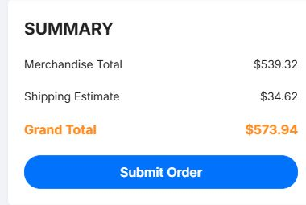
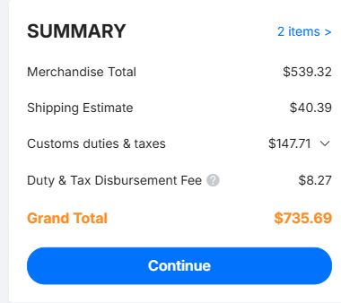
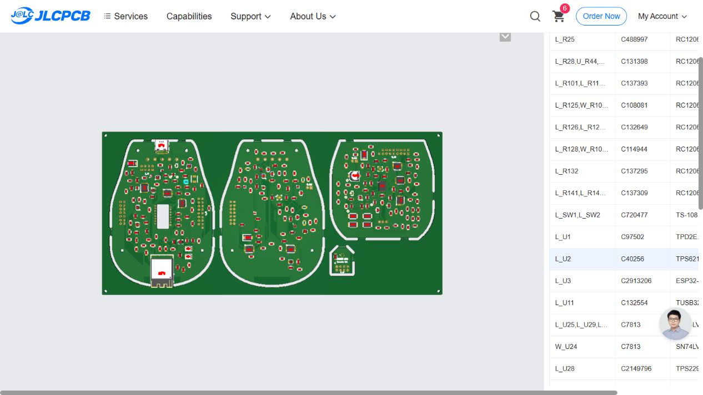

# JLCPCB quotation, 5 November 2026

Five 238 × 114 mm panels contain five complete mouse PCB sets. The uploaded
panel has four designs, two layers, 1.6 mm FR4, 1 oz copper, green mask, white
silk, ENIG 1 µin and the 0.30 mm via option. JLCPCB detected 114 × 238 mm.
The saved bare-board job is MagMouse-238x114-layout_Y19.

| Bare-board checkout for Croatia | USD |
| --- | ---: |
| Five panels | 48.98 |
| Global Standard Direct Line, 12–16 business days | 15.43 |
| Customs duties and taxes shown | 21.67 |
| **Checkout total** | **86.08** |

The cart price for the five panels was €43.72. Global Standard Direct Line was
the lowest carrier charge offered without a customer carrier account. It was
also selectable at checkout. The shipping page lists this service under IOSS
and advises that some arrival charges may be collected separately. Checkout
used USD. No order or payment was submitted.

The assembly upload files specify top-side placement for 247 components per
panel, 1,235 positions across five panels. The BOM uses manufacturer part numbers
and saved JLC part IDs where available. The CPL uses actual translated panel
centers and rotations. L_U35 is the manually installed optical sensor. Actual
assembly cost and populated quantity were checked against supplier stock below.

## Standard assembly quote

JLCPCB job `MagMouse-238x114-layout_Y20`, Standard PCBA
`SMT026110561173-6515285A`, quoted on 5 November 2026. This is an alternative
to the bare-board order above, not an additional charge on that order.

The quote covers five panels with **237 placed components per panel** (1,185
placements total). There are 57 selected BOM rows, representing 55 unique
catalog parts; two pairs of rows share a part number. All selected matches
retain the specified manufacturer part number. The six shortage rows below
are unpopulated. The stock-match page's headline counter was inconsistent
after manual confirmations, so coverage was counted from actual selected
rows and their designators in `assembly-matches.json`.

Standard service allows the ESP32 module, USB-C controller and status LED
that Economic service flagged as Standard-only. JLCPCB adds two 5 mm
assembly rails, changing the quoted manufacturing size from 238 × 114 mm to
238 × 124 mm. The submitted source Gerber panel remains 238 × 114 mm.

| Factory quote | EUR |
| --- | ---: |
| Five bare panels, including added assembly rails | 44.81 |
| Components, including supplier attrition quantities | 237.41 |
| Setup | 22.86 |
| Stencil | 7.34 |
| Mixed-design panel assembly fee | 68.57 |
| Feeder loading | 75.67 |
| SMT assembly | 6.93 |
| X-ray | 14.65 |
| Packaging | 0.48 |
| **Factory total** | **478.70** |

The supplier's assembly subtotal is €433.89 (its displayed rounded line items
sum to €433.91). The displayed build times were PCB 24 hours
and assembly 3–4 days, with no rush surcharge. Quoted shipping weight: 1.91 kg.

| Checkout shipping comparison | Shipping USD | Checkout total USD |
| --- | ---: | ---: |
| **DHL Express, 2–4 business days** | **34.62** | **573.94** |
| UPS Worldwide Express Saver, 6–8 business days | 92.84 | 632.16 |
| FedEx Express, 10–12 business days | 90.46 | 629.78 |
| DHL Express DDP, 2–4 business days | 40.39 | 735.69 |
| FedEx Express DDP, 10–12 business days | 99.46 | 801.25 |

Checkout converts the factory total to **$539.32**. The cheapest carrier is
DHL Express: **$573.94 for five sets**, or $114.79 per set before import charges.
Its checkout has no prepaid duties/taxes line; import taxes and carrier
clearance charges remain payable separately. Global Standard Direct Line
and EuroPacket were not offered for this assembly shipment.

For comparison, DHL DDP shows $147.71 duties/taxes and an $8.27 disbursement
fee, giving **$735.69**, or $147.14 per set, with those charges prepaid.
These are supplier checkout estimates, not an order or a guarantee of final
customs treatment. No order or payment was submitted. The saved checkout is
left on the cheapest DHL option.

## Parts omitted from assembly

| Designators per panel | Specified part | Reason |
| --- | --- | --- |
| E_U27 | MA735GGU-P | No stock for five assemblies |
| L_L1 | SRP4020CC-3R3M | No stock for five assemblies |
| L_U20 | TPD2E2U06DCKR | Insufficient stock including attrition |
| U_R29, U_R41, U_R65, U_R68 | RC1206FR-0722K1L | Insufficient stock including attrition |
| U_U10, W_U23 | ADS7038IRTER | No stock for ten assemblies |
| W_U31 | LM4040AIM3-2.5/NOPB | No stock for five assemblies |
| L_U35 | PMW3360 optical sensor | Intentionally excluded for manual installation |

These are **partially populated boards**, not complete working mice. Eleven
component positions per set remain for manual installation, plus board wires,
mechanical parts, magnets, optical lens and firmware. The preview shows the
four boards and optical aperture in their expected positions; it is a quote
preview, not production approval of every package rotation. Supplier DFM and
final placement confirmation remain necessary before manufacture.

