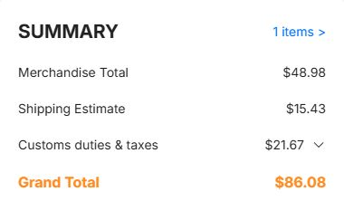

# JLCPCB quotation, 5 November 2026

Five 238 × 114 mm panels contain five complete mouse PCB sets. The uploaded
panel has four designs, two layers, 1.6 mm FR4, 1 oz copper, green mask, white
silk, ENIG 1 µin and the 0.30 mm via option. JLCPCB detected 114 × 238 mm.
The saved bare-board job is MagMouse-238x114-layout_Y19.

| Bare-board checkout for Croatia | USD |
| --- | ---: |
| Five panels | 48.98 |
| Global Standard Direct Line, 12–16 business days | 15.43 |
| Customs duties and taxes shown | 21.67 |
| **Checkout total** | **86.08** |

The cart price for the five panels was €43.72. Global Standard Direct Line was
the lowest carrier charge offered without a customer carrier account. It was
also selectable at checkout. The shipping page lists this service under IOSS
and advises that some arrival charges may be collected separately. Checkout
used USD. No order or payment was submitted.

The assembly upload files specify top-side placement for 247 components per
panel, 1,235 positions across five panels. The BOM uses manufacturer part numbers
and saved JLC part IDs where available. The CPL uses actual translated panel
centers and rotations. L_U35 is the manually installed optical sensor. Actual
assembly cost and populated quantity require supplier stock matching.
