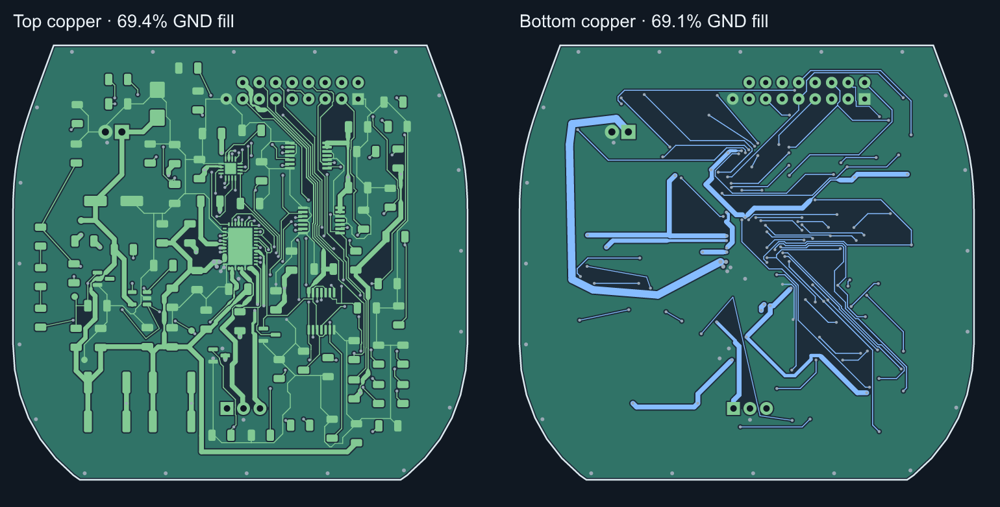

# Wheel profile, grounding and power review

Wheel follows the actual Main outline between y = 26 and 93 mm. Adding
(7.5, 29) mm to a Wheel layout position gives its position in the Main plan
view. The 70 × 67 mm profile provides 4,448.3 mm², up from 3,300 mm².
The current manufacturing panel is 238 × 114 mm. Wheel mounting and vertical
stack fit remain mechanical acceptance items.

R115, R116 and R117 form a vertical row in feedback-chain order on the left.
Their two interconnections measure 6.65 mm combined, down from 63.0 mm.
The complete BRAKE_OUT branch network grew from 42.7 to 66.3 mm while BRAKE_SENSE
fell from 41.1 to 37.7 mm. The four nets together are about 36 mm shorter.
Check comparator response and noise on hardware. Repositioning R91 shortened
its two local routed ends from 6.30 to 2.60 mm. The minimum separate-component
body-and-land clearance on Wheel measures 2.010 mm.

## Return copper

The earlier trace views suppressed all pours. Wheel had 1,978.0 mm² of front
GND fill, 2,097.7 mm² of back GND fill and two GND vias before this revision.
The enlarged board has 3,088.1 mm² of front fill (69.42%) and 3,073.2 mm² of
back fill (69.09%). The board now has 29 GND vias. The added stitching joins
both layers in the new margins and near the circuitry. U21 PGND pin 12 has a
1.25 mm front trace to an off-pad GND via. The corresponding Q5 source escape
is 0.50 mm. Copper fill area measures coverage. Return impedance, EMI, and
motor-driver temperature still require measurements on the assembled stack.

## DC path screening

The table uses direct KiCad copper contacts with 35 µm outer copper, copper
resistivity at 80 °C and an assumed 20 µm of barrel plating. Each path charges
the full traversed segment or barrel and takes no credit for current sharing.
Barrel length comes from the individual board thickness. The results exclude
connectors, wire, silicon, solder and the GND return. See the
[per-path neck lengths, positions, via diameters, losses and input cases](power-and-ground.json).

| PCB path | Previous estimate | Revised estimate | Voltage drop at stated current |
| --- | ---: | ---: | ---: |
| Lower stack PWR_5V to regulator U2 pin 2 | 83.2 mΩ | 48.6 mΩ | 48.6 mV at 1 A |
| Upper U12 output to U13 input | 122.1 mΩ | 48.4 mΩ | 96.8 mV at 2 A |
| Upper U13 output to Wheel harness J10 | 32.8 mΩ | 18.3 mΩ | 36.5 mV at 2 A |
| Wheel J11 to motor driver U21 pin 9 | 67.5 mΩ | 33.7 mΩ | 67.3 mV at 2 A |
| Wheel driver phase pins to J5 across all six paths | — | 22.8–38.1 mΩ | 11.4–19.1 mV at 0.5 A |

Added feeds use 0.90 mm copper on Lower, 1.50 mm and 1.35 mm on Upper and
1.15 mm on Wheel, with parallel via connections where space permits. The
checked power paths use 0.30 mm drills and 0.45–0.65 mm lands. A single Wheel
barrel at the assumed plating measures about 1.81 mΩ, giving 0.45 mW at
0.5 A or 7.23 mW at 2 A. The new Wheel supply transition has three barrels.
The calculation does not require them to share equally. Actual finished plating
and copper thickness belong in the fabrication handoff. [JLCPCB plating guidance](https://jlcpcb.com/blog/pcb-plating-thickness)

For a uniform external conductor at 35 µm copper, the IPC-2221 correlation
gives nominal widths of 0.115, 0.300 and 0.781 mm at 0.5, 1 and 2 A for a
10 °C rise. The Wheel phase paths have a minimum 0.150 mm width, meeting this
screen at the project's initial 0.5 A phase-current limit. The brake paths
also pass at the 6.5 V / 11.75 Ω peak case of 0.553 A. The input and regulator
pin escapes include narrower sections than the 1 A and 2 A uniform-width
targets. At 2 A the worst Wheel VM path contains 0.752 mm total below target,
including a 0.237 mm neck. The 10 °C uniform-width screen does not establish
the actual temperature of such short sections. [TI calculation, equation 3](https://www.ti.com/lit/an/snva766/snva766.pdf)

The 2 A value exercises the shared input ceiling. U13's nominal 2.02 A fault
threshold and the motor phase current are separate quantities. Continuous
2 A operation remains unqualified. At increasing loads, measure input and
local VM-to-PGND voltage simultaneously and record the temperatures of the
narrow sections, via transitions and driver in the closed mouse. Check rail
droop and brake response during regeneration. [Project power budget](../../../../docs/power.md)
